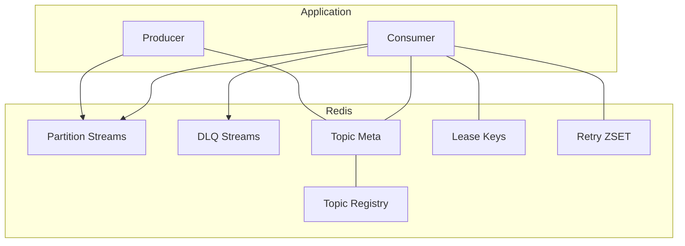

# 架构总览

该文档概述系统整体架构，并突出 MQ（Redis Streams）子系统的角色与交互。详细设计见 `MQ-Design.md`。

## 模块

Gradle 多模块工程，模块清单与 `settings.gradle` 一致（20 个）：

| 层 | 模块 |
|---|---|
| Tier 1 核心抽象 | `core`（API 抽象）、`runtime`（流处理运行时引擎） |
| Tier 2 基础设施 | `mq`、`registry`、`config`、`state`、`checkpoint`、`watermark` |
| Tier 3 特性 | `window`、`aggregation`、`table`、`join`、`cdc`、`sink`、`source` |
| Tier 4 高级特性 | `reliability`、`cep` |
| Tier 5 集成 | `spring-boot-starter`、`examples`、`benchmark` |

## 源码分层与当前实现

本节补充层级表：职责由 import、调用通道、存储、配置和生命周期推导得出。证据与拆分理由见 [源码分层分析](./Source-Layer-Analysis.md)；术语见 [术语表](./Glossary.md)。

- **契约与运行时**。契约层是 `core`；`runtime` 中拆分内存与 Redis 两个执行引擎。实现入口见 `core/src/main/java/io/github/cuihairu/redis/streaming/api/stream/DataStream.java` 与 `runtime/src/main/java/io/github/cuihairu/redis/streaming/runtime/redis/RedisStreamExecutionEnvironment.java`；执行 schema 是 `RedisRuntimeConfig.java`；没有独立传输协议文件。文案在 [核心 API](./Core.md) 与 [运行时](../runtime.md)。
- **基础通道**。MQ、registry、config 拥有共享 Redis 传输/协调格式。实现分别位于各模块 `src/main/java`；schema 是 `MqOptions`、`NamingServiceConfig` 和 config `BaseRedisConfig`；Redis Streams 记录与 Lua 嵌在服务类中。文案在 [MQ 设计](../MQ-Design.md)、[Registry 设计](../Registry-Design.md) 与 [配置中心](../config.md)。
- **语义算子**。State、checkpoint、watermark、window、aggregation、table、join 定义数据/时间语义，并把执行委托给运行时。实现跟随各模块 API；schema 是 StateDescriptor 和运行时配置；协议语义是 Java record/interface。文案见 [源码分层分析](./Source-Layer-Analysis.md) 列出的主题文档。
- **边界适配**。CDC、source、sink、reliability、CEP 翻译外部协议或提供横切语义。配置是 connector builder/类，而非集中 schema；CDC 与 sink 记录是 Java/JSON。文案在 [CDC](../CDC.md)、[Source/Sink](../source-sink.md)、[可靠性](../reliability.md) 与 [CEP](../CEP.md)。
- **控制、装配与交付**。作业控制面与 agent 在 `runtime/.../control`；Spring Starter 与 metrics 绑定/装配功能；examples/benchmark 保持不发布。schema 是 `RedisStreamingProperties`、控制/agent 属性和示例 `application.yml`。文案在 [控制面设计](../Control-Plane-Design.md)、[Spring Boot Starter](../Spring-Boot-Starter.md) 与 [示例](../Examples.md)。

## 逻辑架构

## 运行时线程模型
- 每个被分配的分区一个串行 Worker；独立调度池负责租约续约、pending 扫描与接管（`XPENDING`+`XCLAIM`）、指标与延迟重试搬运（调度线程数由 `MqOptions.schedulerThreads` 控制，默认 2）。

## 故障处理
- 实例宕机：租约过期，其他实例竞争获取；对孤儿 pending 执行 `XPENDING`+`XCLAIM` 接管。
- 处理失败：按策略重试或入 DLQ；DLQ 可回放。

## 取舍
- 无协调器、低运维，但再均衡是最终一致；通过短 TTL 与幂等性降低风险。

## 核心命令与 Kafka 映射（速览）
- 生产写入：`XADD stream:topic:{t}:p:{i}` ≈ Kafka Producer 发送到分区（键格式见 `mq/.../partition/StreamKeys.java`，前缀可通过 `StreamKeys.configure` 调整）
- 组创建：`XGROUP CREATE` ≈ Kafka 创建消费组
- 组读取：`XREADGROUP GROUP <g> <c>` ≈ Kafka 拉取（含批量与阻塞）
- 提交位点：`XACK` ≈ Kafka commit
- 待处理查询：`XPENDING` ≈ in-flight（Kafka 无直接命令）
- 孤儿接管：`XPENDING`+`XCLAIM` ≈ 再均衡后接管未确认记录
- 分区独占：`SET NX EX` + `EXPIRE`（租约）≈ 组协调器分配分区
- 延迟重试：`ZADD/ZRANGEBYSCORE/ZREM` + `EVAL`（Lua搬运）≈ 重试主题/延迟回放
- 保留/裁剪：`XTRIM MAXLEN/MINID` ≈ retention.bytes/retention.ms
- 死信：`XADD stream:topic:{t}:dlq` ≈ DLQ 主题；回放 `XRANGE + XADD`
